# CourseForge Studio user guide

This guide shows how to build and publish courses with CourseForge Studio. It starts with a first course you can finish in about ten minutes, then goes through each part of the editor. The screenshots use the two sample courses that come with the program.

**Contents**

1. [Install and open CourseForge Studio](#1-install-and-open-courseforge-studio)
2. [A tour of the window](#2-a-tour-of-the-window)
3. [Your first course in ten minutes](#3-your-first-course-in-ten-minutes)
4. [Slides and scenes](#4-slides-and-scenes)
5. [Working on the canvas](#5-working-on-the-canvas)
6. [Text](#6-text)
7. [Pictures, video and audio](#7-pictures-video-and-audio)
8. [States, layers and triggers](#8-states-layers-and-triggers)
9. [Variables](#9-variables)
10. [The timeline and animations](#10-the-timeline-and-animations)
11. [Quizzes](#11-quizzes)
12. [Lessons courses](#12-lessons-courses)
13. [Themes and the image library](#13-themes-and-the-image-library)
14. [Check and Preview](#14-check-and-preview)
15. [Publish](#15-publish)
16. [Bring in a Storyline 360 project](#16-bring-in-a-storyline-360-project)
17. [Take your work into Storyline 360](#17-take-your-work-into-storyline-360)
18. [Saving, undo and recovery](#18-saving-undo-and-recovery)
19. [Keyboard shortcuts](#19-keyboard-shortcuts)
20. [Claude, your AI assistant](#20-claude-your-ai-assistant)
21. [Troubleshooting](#21-troubleshooting)

---

## 1. Install and open CourseForge Studio

**Install.**
1. Download `CourseForge-Studio-Setup-<version>.exe` from the [Releases page](https://github.com/WilliamEbong/courseforge-studio/releases/latest).
2. Double-click it. It installs for your Windows account only: there is no administrator prompt and nothing else to install.
3. The installer adds **CourseForge Studio** to the desktop and the Start menu, then opens the program.

> The installer is not code-signed yet, so Windows SmartScreen may say it "protected your PC" the first time. Click **More info**, then **Run anyway**.

**Open.** Double-click **CourseForge Studio** on the desktop or in the Start menu. The program opens in its own window and works without an internet connection. Opening it a second time brings the open window to the front. Closing the window quits it.

Your courses are kept in **Documents\CourseForge Studio**. The first time you open the program, that folder gets two sample courses:

- **Lab Safety Essentials**, a slide course with layers, triggers, variables and a quiz.
- **Lab Basics**, a lessons course that scrolls like a web page.

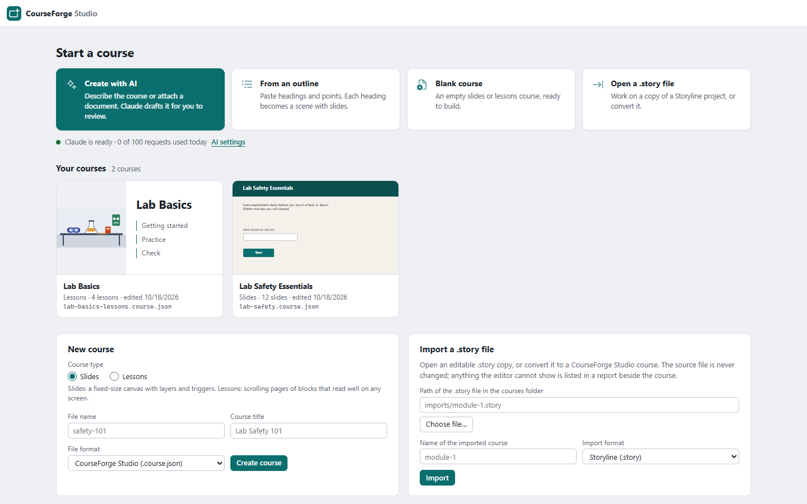

The start screen shows every course in the folder as a small picture of its first slide. From here you can:

- **Open** a course by clicking it.
- **Create with AI**: describe the course, optionally attach documents, and Claude drafts it for you to review. See [section 20](#20-claude-your-ai-assistant).
- **From an outline**: paste headings and bullet points; each heading becomes a scene with slides.
- **Blank course**: choose **Slides** or **Lessons**, type a file name (lowercase letters, digits and dashes, for example `safety-101`) and a title, then click **Create course**. Courses are saved as `.course.json` files; you can choose Storyline's `.story` format for slide courses instead.
- **Open a .story file**: see [section 16](#16-bring-in-a-storyline-360-project).

**Updates.** When a new version is published, CourseForge Studio downloads it in the background and asks whether to **Restart to update**. Your courses are never changed by an update.

**Remove.** Open Windows **Settings > Apps > Installed apps**, find **CourseForge Studio** and choose **Uninstall**. Your courses stay in Documents\CourseForge Studio until you delete them yourself.

## 2. A tour of the window

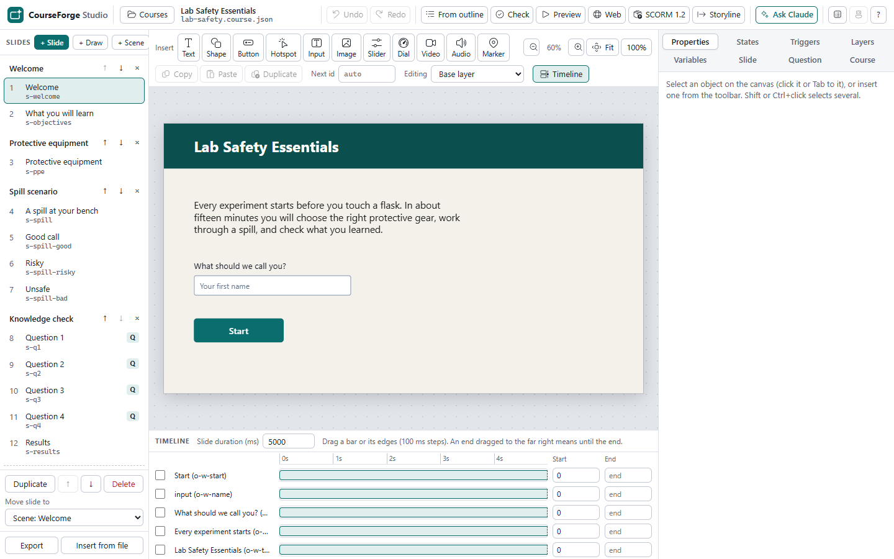

| Area | What it is for |
|---|---|
| **Header** (top) | **Courses** takes you back to the start screen. Next to the course name, a status says whether your last change is saved. **Undo** and **Redo** come next, then **From outline**, **Check**, **Preview**, and **Publish** (Web, SCORM 1.2, Storyline). **Ask Claude** opens the AI assistant (Ctrl+I). **Command log** and **Agent** show your edits as commands for other AI tools. **?** lists the keyboard shortcuts. |
| **Slides** (left) | Every scene and its slides, in order. Click a slide to edit it. Use the arrows to reorder scenes, and drag slides to reorder them or move them to another scene. **+ Slide**, **+ Draw** and **+ Scene** add new ones. |
| **Insert bar** (above the canvas) | Adds text, shapes, buttons, hotspots, text inputs, images, sliders, dials, video, audio and markers to the slide. Also holds zoom, copy, paste, duplicate, the layer you are editing, and the Timeline switch. |
| **Canvas** (centre) | The slide itself. Click an object to select it. |
| **Timeline** (below the canvas) | When each object appears and disappears. |
| **Inspector** (right) | Settings for whatever is selected, in tabs: Properties, States, Triggers, Layers, Variables, Slide, Question and Course. |

The editor is laid out for windows at least 1024 pixels wide. In a narrower window it scrolls sideways and shows a note.

## 3. Your first course in ten minutes

1. On the start screen, under **New course**, choose **Slides**, type `my-first-course` as the file name and `My first course` as the title, then click **Create course**.
2. Select the initial slide (or click **+ Slide** if the course is empty). In the inspector's **Slide** tab, give it a title such as *Welcome*.
3. Click **Text** in the Insert bar. Type your welcome message in the **Text** box in the Properties tab, then click anywhere outside the box to save it.
4. Click **Image**. Click **Choose file…**, pick a picture from your computer and describe it in **Alt text**. Click **Insert image**. (Or open the **Library** tab and pick one of the built-in pictures.)
5. Click **Button**. In Properties, change its text to *Continue*.
6. Add a second slide with **+ Slide**.
7. Go back to the first slide and select the button. Open the **Triggers** tab and click **+ Add trigger**. Set **Event** to *click*, **Event object** to your button, and **Action** to *jump* to *next slide*. Click **Add trigger**.
8. Click **Preview** and try your button.
9. Click **Web** under Publish. The finished course goes into `Documents\CourseForge Studio\dist\my-first-course-web`. Open its `index.html` in any browser. It works offline.

Every change saves itself as you go. There is no Save button.

## 4. Slides and scenes

- **Scenes** group slides, much like chapters. Rename a scene by clicking its title. Use **↑** and **↓** next to a scene to move it, and **×** to delete it.
- **Reorder slides** by dragging them in the list, or with the **↑** and **↓** buttons at the bottom. To move a slide to another scene, choose the scene under **Move slide to**.
- **Duplicate** copies the current slide. **Delete** removes it after asking you.
- **Export** saves the current slide as a reusable file. **Insert from file** adds a saved slide to any course; its objects get new ids so nothing clashes.
- The **Slide** tab holds the slide's title, background colour, duration, whether it moves on by itself at the end of its timeline (**advance**), what happens when a learner comes back to it (**revisit**: reset or resume), and speaker notes.
- **From outline** builds a course from a plain-text outline. Start a scene with `# `, a slide with `## `, and bullet points with `- `. Plain lines become the slide text. For a question, write `? ` and the question, then a choice on each line after it with `[x] ` for correct or `[ ] ` for wrong, or `= ` for an accepted fill-in answer.

## 5. Working on the canvas

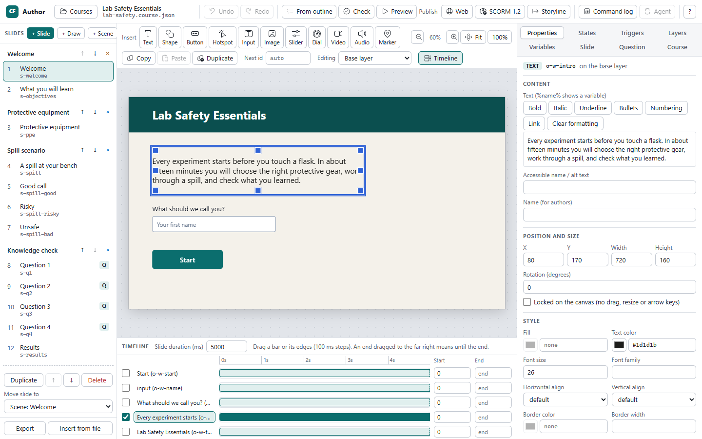

**Selecting**
- Click an object to select it. Shift+click or Ctrl+click adds objects to the selection or removes them.
- Drag across empty canvas to draw a selection box. Every object fully inside the box is selected. Hold Shift to add to what is already selected.
- Tab moves through the objects, Ctrl+A selects all of them, and Escape clears the selection.

**Moving and sizing**
- Drag an object to move it. Guides appear when its edges or centre line up with the slide's edges or centre, or with another object; the object snaps to them. Hold **Alt** while dragging to move freely.
- Arrow keys move the selection by 1 pixel, Shift+arrows by 10. If you hold a key down, the object keeps up with you and the move counts as one change.
- Drag one of the eight square handles to resize. Corner handles change width and height together; hold **Shift** on a corner to keep the proportions.
- Type exact numbers in **Position and size** in the Properties tab, including **Rotation**.
- **Locked on the canvas** stops an object being dragged, resized or nudged by mistake. Imported logos and footers start out locked.

**The object menu**

Right-click an object, or press Shift+F10 or the Menu key, for the object menu. Move through it with the arrow keys.

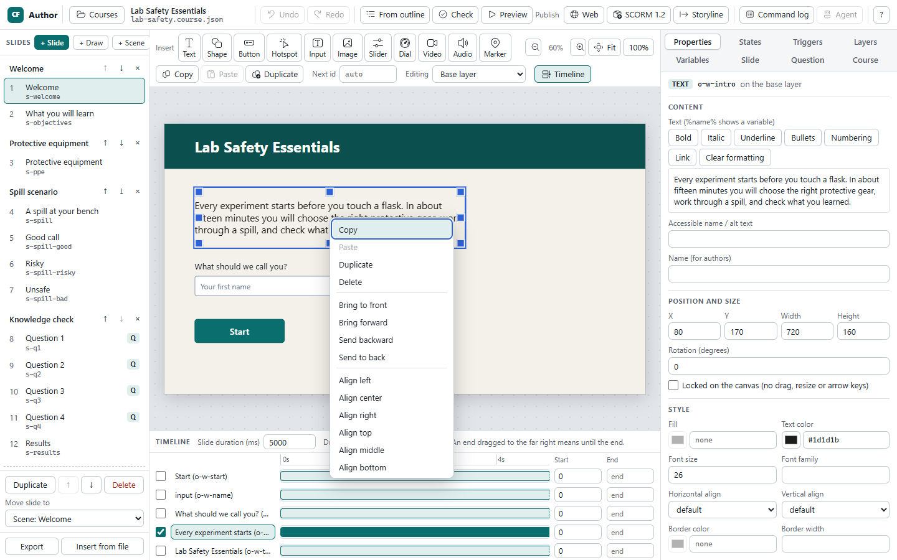

- **Copy**, **Paste**, **Duplicate** and **Delete**. Paste works on any slide or layer. Triggers that belong to the copied objects come along.
- **Bring to front**, **Bring forward**, **Send backward** and **Send to back** change the stacking order. Objects higher up the stack cover lower ones, and the timeline lists the front object first.
- **Align** lines up the selection by its left, centre, right, top, middle or bottom edge. A single object aligns to the slide. To space three or more objects evenly, use **Distribute** in the Properties tab.

**Zoom**
- Use **−** and **+** in the Insert bar, **Fit** to fit the slide in the window, or **100%** for actual size. The keyboard equivalents are Ctrl+−, Ctrl+= and Ctrl+0. When the slide is bigger than the window, scroll to move around.

## 6. Text

Text boxes, shapes and buttons can all hold text. Edit it in the **Text** box in the Properties tab.

- Select words and use **Bold**, **Italic** or **Underline** (Ctrl+B, Ctrl+I, Ctrl+U), **Bullets**, **Numbering** or **Link**. **Clear formatting** removes formatting from the selected text.
- Click outside the box to save. All the changes you made in the box count as one step you can undo.
- Pasted text arrives as plain text, so it picks up your course's styling.
- Write `%name%` to show a variable's value, for example *Well done, %learner%!* (see [section 9](#9-variables)).
- **Font size**, **Font family**, colours, alignment, padding, borders and shadow are in the **Style** group. Fonts are not embedded in published courses, so use fonts your learners have, or the system font.
- Fill in **Accessible name / alt text** when the visible text does not describe the object well enough for a screen reader. Fill in **Name (for authors)** to give the object a name you will recognise in the timeline and trigger lists.

## 7. Pictures, video and audio

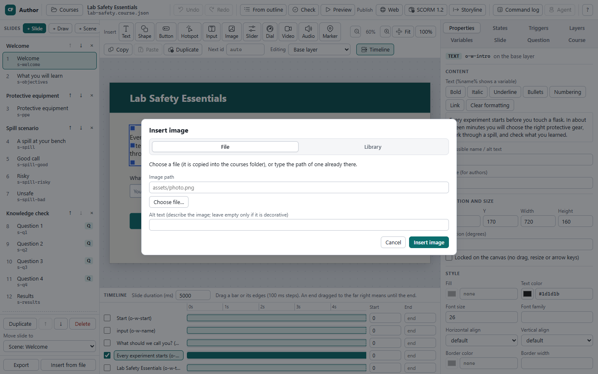

- **Image**: click **Choose file…** to copy a picture into your course folder, or use the **Library** tab for the built-in pictures. Always describe the picture in **Alt text**. Leave it empty only if the picture is purely decorative.
- **Video** and **Audio**: choose the media file. You can also choose a captions file (`.vtt`) and write a description. Learners get play, pause and a captions button; Ctrl+Alt+C switches captions on and off.
- Files are published exactly as you add them, so keep them a sensible size.
- **Slider** and **Dial** each create a number variable that changes as the learner moves them. **Hotspot** is an invisible click area. **Input** lets the learner type text into a variable, up to its **Most characters** (400 unless you change it); the learner sees the count while typing. Tick **Report the answer to the LMS (ungraded)** to send the text to a SCORM LMS as an ungraded answer when the learner leaves the slide: it shows in LMS reports and never affects the score. **Marker** is a small button that opens a label.

## 8. States, layers and triggers

These three work together to make a slide interactive.

**States** change how one object looks. Every object has built-in states (Normal, Hover, Down, Selected, Visited, Disabled, Hidden); you can also make your own. In the **States** tab, set a state's fill, text colour or text. A button shows its Hover state automatically when the pointer is over it.

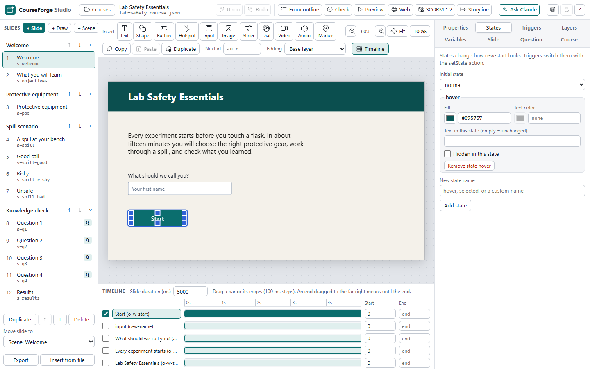

**Layers** are panels that appear on top of a slide, for feedback, pop-ups or extra detail. In the **Layers** tab, add a layer, then choose it under **Editing** in the Insert bar to put objects on it. Layer settings include **modal** (the learner must close it before going on), hiding the base layer's objects, and pausing the slide's timeline while it shows.

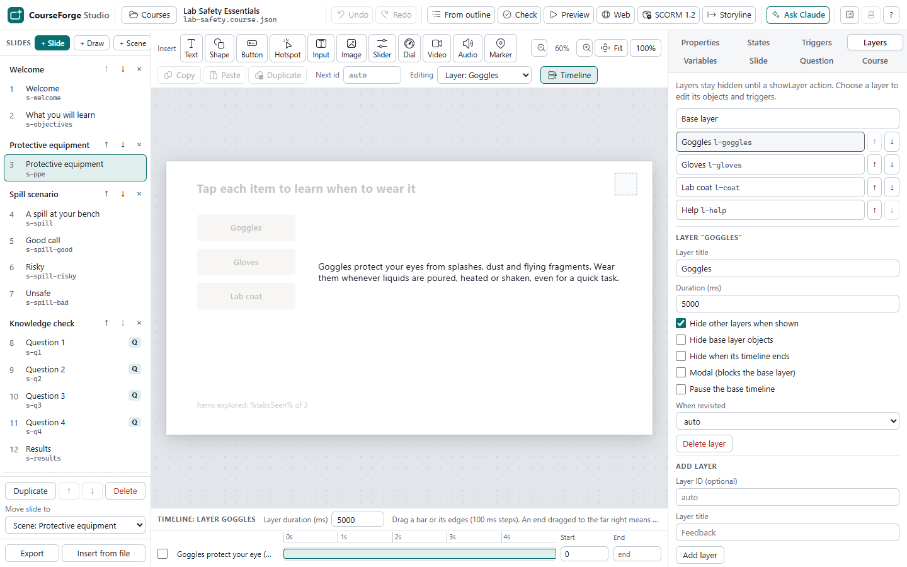

**Triggers** are the rules: *when* something happens, *if* conditions are true, *do* actions in order. The **Triggers** tab lists them in the order they run.

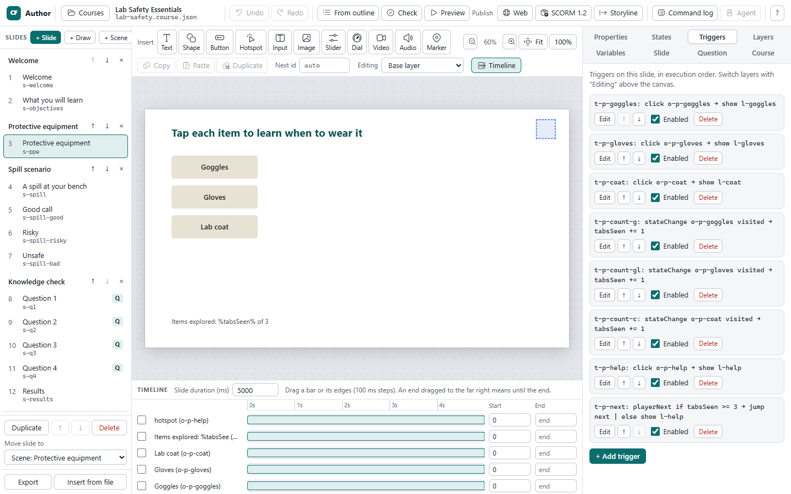

To add one, click **+ Add trigger**:

1. **When**: choose the event. You can respond to a click, the pointer entering or leaving an object, the timeline starting or ending, a set time on the timeline, a variable changing, an object's state changing, a key press, the player's Next or Prev button, or media finishing.
2. **If** (optional): add conditions on variables or object states, all of them or any of them.
3. **Do**: add actions in order:
   - change a variable or an object's state, or move keyboard focus
   - show or hide a layer
   - jump to a slide or scene
   - submit, reset or review a quiz
   - open a web page
   - play, pause or stop media

   A jump ends the list.
4. **Else** (optional): actions for when the conditions are false.

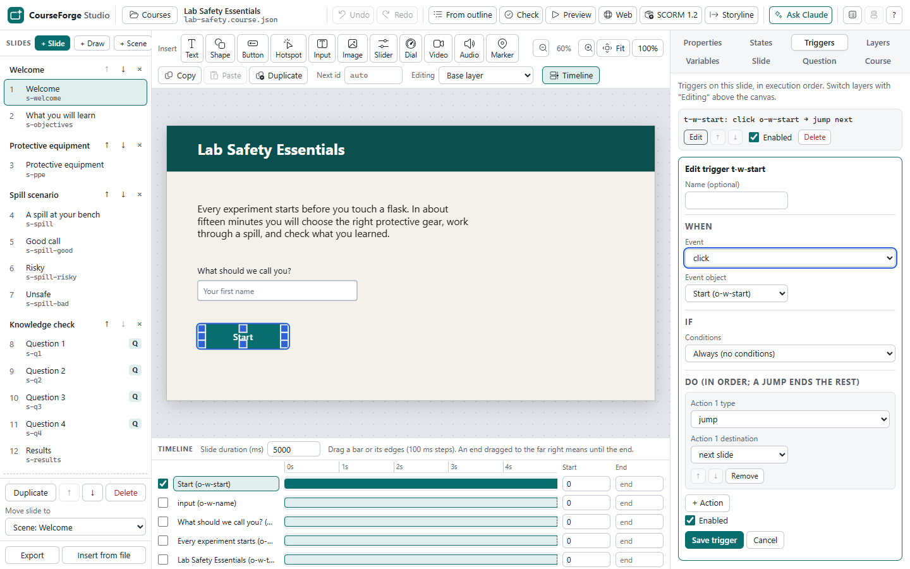

Use the arrows to change the order, the checkbox to switch a trigger off without deleting it, and **Edit** to change it.

## 9. Variables

The **Variables** tab lists the course's variables: **text**, **number** or **true/false**, each with a starting value. Triggers change them, and conditions test them. Text can show a variable's value with `%name%`. Each quiz also has ready-made variables such as `quiz-id.scorePercent` and `quiz-id.passed`. Renaming a variable updates every place that uses it.

## 10. The timeline and animations

Click **Timeline** to show or hide it. Each row is an object, with the front object first.

- Drag a bar to change when an object appears. Drag its edges to change when it appears and disappears, in 100 ms steps. A bar dragged to the right end stays until the slide ends.
- Type exact times in **Start** and **End**, and set the slide's length in **Slide duration**.
- Tick the box on a row to add that object to the selection.
- **Animation** in the Properties tab adds an entrance or exit effect (fade, fly in, grow or zoom) with a duration and, for fly, a direction. Learners who ask their system for reduced motion see the object appear without movement.

## 11. Quizzes

**Question slides.** Select a slide, open the **Question** tab and click **Make this a question slide**. The question types are:

- multiple choice
- multiple response
- true/false
- fill in the blank
- matching (a drop-down list for each row)
- sequence (put the items in order)
- hotspot (click the right place on the slide)
- drag and drop

Write the prompt, the choices and the feedback, set the points and the number of attempts (0 means unlimited), then click **Save question**.

The full list applies to JSON courses. Native `.story` authoring currently supports multiple choice, multiple response and true/false; other imported question types may play but unsupported native edits are refused.

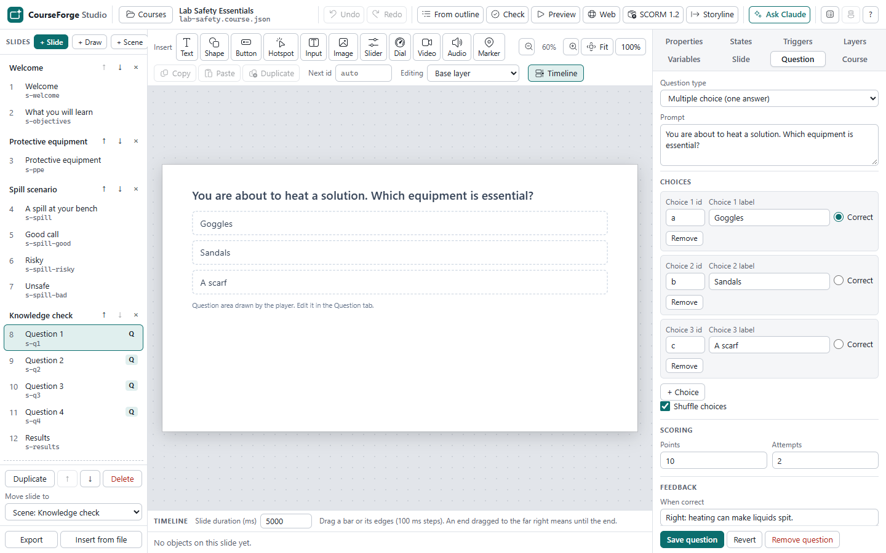

**Quizzes and results.** In the **Course** tab, add a quiz, choose which questions belong to it, set the pass mark and click **Add a results slide**. The results slide shows the score with a pass layer and a fail layer. It also gets a **Retry** button and a **Review quiz** button. You can turn Review off in the quiz settings.

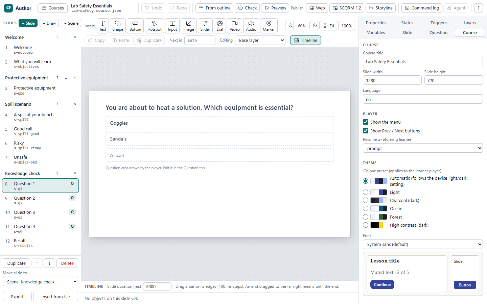

**Review quiz.** After finishing, learners can step through their answers. Each question is locked and marked Correct or Incorrect, with the right answer shown. **Exit review** returns them to the results slide. Reviewing never changes the score.

**Question banks and draws.** Put questions in a bank (**+ Bank** in the slide list), then use **+ Draw** to add a slide that picks some or all of the bank's questions when the learner arrives, in random order if you like. You can always include or always leave out particular questions.

**Completion.** The Course tab lets you track a percentage of slides viewed, an exact number, or quiz results. Each quiz has its own **Use result** checkbox. Native projects must include every quiz with an enabled results submission; adding a native results slide adds its criterion automatically.

## 12. Lessons courses

A lessons course is an outline of sections and lessons that learners scroll through. It reads well on phones as well as desktops.

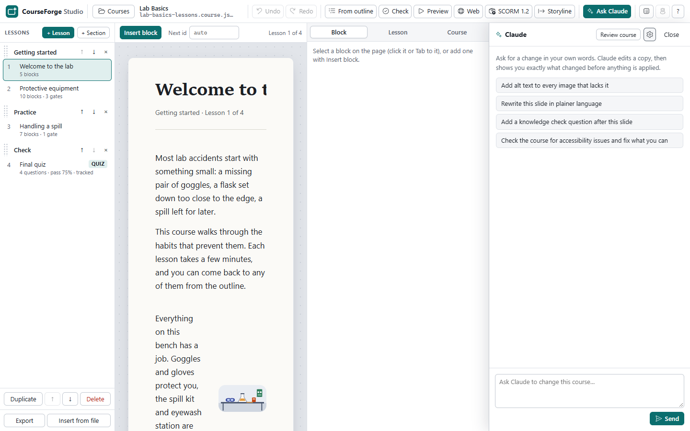

- Add sections and lessons in the outline on the left. Add blocks to a lesson with **Insert**. The block types are:
  - heading, text, list, quote, divider
  - image, image and text, gallery, video, audio
  - accordion, tabs, flashcards, labelled graphic, process, timeline
  - button, continue, question, sorting, scenario
- A **continue** block can hold back what comes after it until the learner has finished the blocks above.
- A **quiz lesson** holds only question blocks and shows them one at a time, with a score at the end.
- Select a block card to edit it on the right. Alt+↑ and Alt+↓ move it. Delete removes it.
- **Export** and **Insert from file** reuse lessons between courses.

## 13. Themes and the image library

- **Player style** (Course tab) selects Modern or Classic. New `.story` courses select Modern. CourseForge Studio uses its responsive charcoal presentation for Modern; explicit theme colours take precedence. Imported native player colours and controls remain preserved in the file, but CourseForge Studio does not reproduce every native setting.
- **Theme** (Course tab) sets the player's colours and font for learners. There are six presets: Default (Modern uses charcoal; otherwise follows the learner's light or dark setting), Light, Charcoal, Ocean, Forest and High contrast. Every preset meets WCAG AA contrast.
- **Library** (in the Image dialog) holds original pictures you can use freely in your courses.

## 14. Check and Preview

**Check** runs the same validation the publisher uses, plus an accessibility review. It flags:

- pictures without alt text, and controls or inputs without a name or label
- video and audio without captions
- low colour contrast and very small text
- slides without a title, headings out of order and an unusual tab order
- timing too short to read

Each item says how to fix it, and **Go to** takes you there.

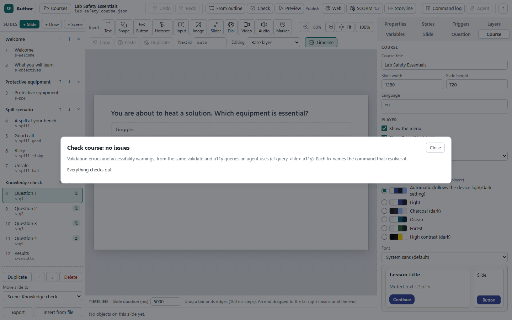

**Preview** plays the course from the slide you are on, inside the editor. **Debug** in the preview shows variables and the last events. You can also open the preview in its own tab.

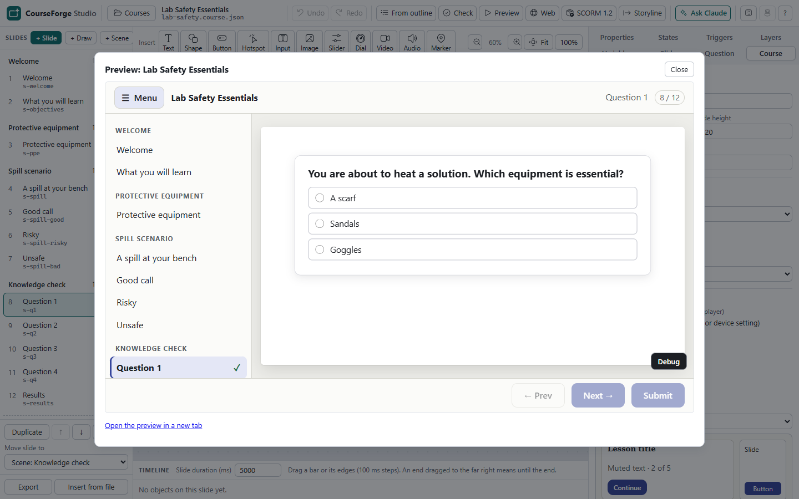

## 15. Publish

Click a button under **Publish** in the header:

- **Web**: a folder that plays in any modern browser, online or offline, straight from `index.html`. Nothing is loaded from the internet.
- **SCORM 1.2**: a ZIP package for your learning management system (LMS). It reports completion, score, pass or fail and each answer, and lets learners resume where they left off. Upload the ZIP to your LMS's SCORM activity; keep the `.story` file as your editable source.
- **Storyline**: see [section 17](#17-take-your-work-into-storyline-360).

Published folders go to `Documents\CourseForge Studio\dist\<course name>-web` or `-scorm12`. SCORM also creates `<course name>-scorm12.zip` beside its folder; the publish message shows the ZIP path.

For slide courses, completion settings affect the score stored by the LMS. Once a criterion reports passed, failed or completed, later answers still count toward the displayed quiz result, but the LMS score stops changing. If you need the final quiz score in the LMS, use quiz completion without an earlier slide-count criterion.

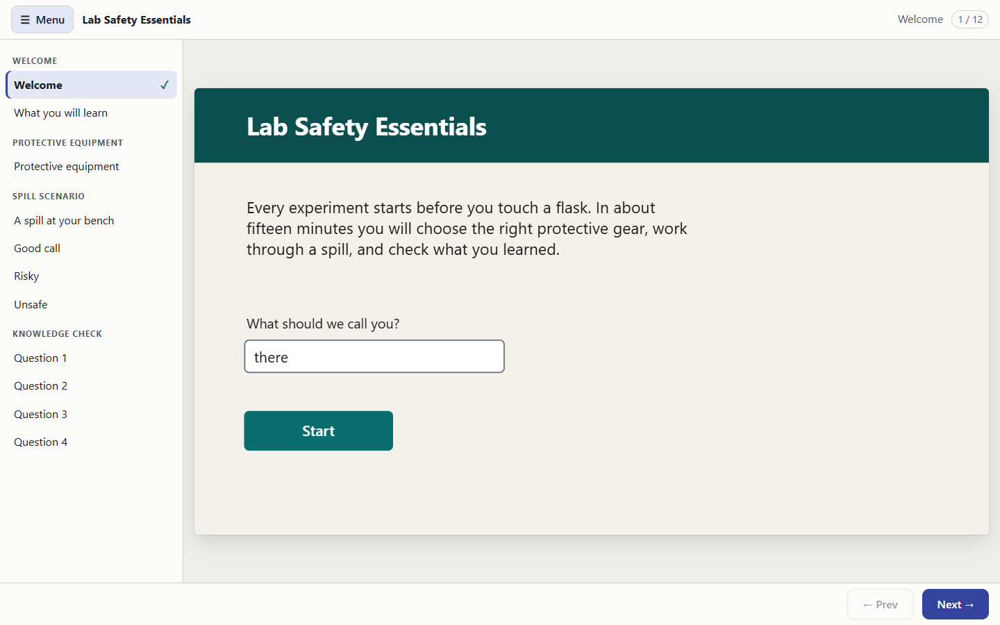

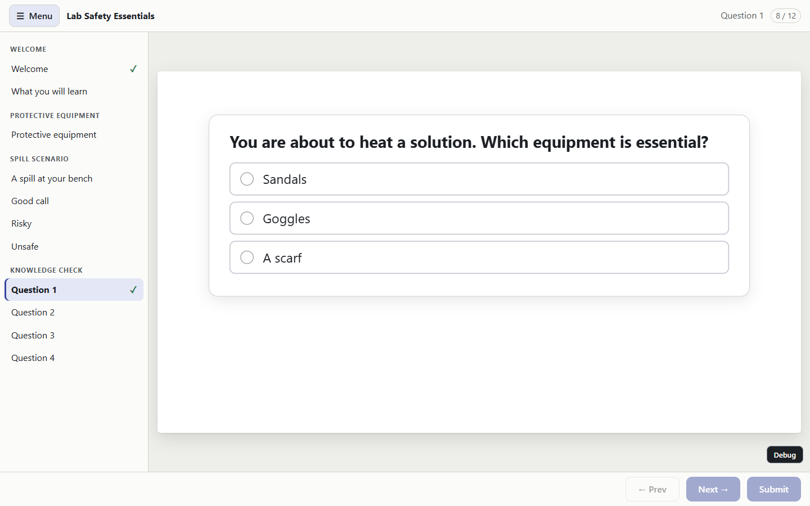

Learners can use the course with the keyboard alone, and with a screen reader. Questions on small screens move below the slide at a readable size.

> SCORM 1.2 limits resume data to 4,096 characters. A very long course with many variables and visited layers can go over that limit. When it does, the LMS keeps the last resume point that fitted. **Check** and SCORM publishing warn when a course could go over, counting every text input as full; lower **Most characters** on inputs to fix it. Test long courses in your LMS.

## 16. Bring in a Storyline 360 project

Import creates a new course and leaves the source file unchanged. Opening an existing `.story` already in your courses folder edits that file directly.

1. On the start screen, under **Import a .story file**, click **Choose file…** and pick the `.story` file. It is copied into your courses folder.
2. Check the course name (lowercase letters, digits and dashes), choose native `.story` or conversion to JSON, and click **Import**. Native keeps the source archive's unedited content; JSON conversion keeps the mapped course model.
3. The new course opens. Next to it, `<name>.import-report.json` lists anything that could not come across exactly. Each entry says what it is, where it is and why.

**What comes across:**
- scenes and slides
- text, with bold, italic, underline, colours, sizes, fonts, bullets, numbering and links
- shapes, lines, arrows, pictures and buttons, with their states
- layers, triggers and variables
- the question types listed in [section 11](#11-quizzes), with feedback, points and attempts
- question banks and draws, quizzes and results slides, including review
- sliders, dials, hotspots, markers, and video with captions
- theme colours, and slide backgrounds inherited from slide layouts and masters
- master logos and footers, placed on each slide and locked

**What to check after import:**
- Approximations are listed in the report as `heuristic`. Examples are block arrows drawn as plain arrows and gradient fills turned into solid colours.
- Some formatting cannot come across, including paragraph spacing and unusual list markers. On Windows, EMF pictures are rendered to PNG for display and publishing; the original media remains in the native archive. Failed conversions are reported.
- Supported text boxes shrink their displayed text to fit while retaining the authored font size. You can edit their text, but CourseForge Studio cannot yet resize fitted native text boxes. Converted vector and table graphics are display-only in native files.
- Supported slide-count and quiz completion settings and LMS reporting statuses are imported. Unsupported tracking and player options are reported; check completion, scoring and resume in your LMS.

Native support is experimental. Full-course compatibility with Storyline 360 has not yet been verified. Review the report and keep your original file.

## 17. Take your work into Storyline 360

A native course is already saved as a `.story` file; no export is needed to obtain it. Check the compatibility limits in section 16 before opening it in Storyline 360.

For additional interchange formats, click **Storyline** under Publish. The dialog offers three ways to move your work into Storyline 360:

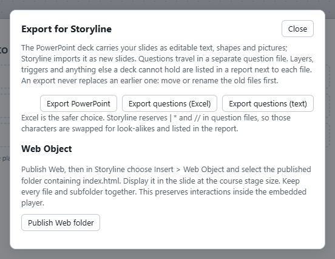

1. **Export PowerPoint** makes a `.pptx` deck with your slides as editable text, shapes and pictures, plus their speaker notes. In Storyline, choose **Import > Import PowerPoint** (on the start screen, or under File) and pick the deck. Importing from the start screen sets the project to the deck's slide size.
2. **Export questions (Excel)** or **(text)** makes a question file. In Storyline, choose **Import > Import questions from file**. Excel is the safer choice. Storyline reserves the characters `|`, `*` and `//` in question files, so CourseForge Studio swaps them for look-alike characters and lists every change in the report.
3. **Web Object** keeps the course fully interactive inside Storyline. Publish Web, then in Storyline choose **Insert > Web Object** and pick the published folder (the one holding `index.html`). Show it at the course's slide size and keep all its files together.

Storyline cannot take layers, triggers, variables and timing from a PowerPoint deck. The report next to each exported file lists exactly what was left out.

## 18. Saving, undo and recovery

- Every change is saved to the course file as soon as you make it. The status next to the course name shows **Saving…**, then **All changes saved**. If a change is refused, it shows **Not saved**: the field keeps what you typed and explains the problem, so you can correct it.
- **Undo** and **Redo** (Ctrl+Z, and Ctrl+Y or Ctrl+Shift+Z) go back and forward through the last 100 changes. Hover over the buttons to see what they will undo or redo. The history is kept with the course, so it survives closing the program.
- Native history lives in `<file>.history/` and can hold 101 full archive snapshots. Keep enough disk space for large projects. Unsupported native changes fail without replacing the saved file; close the project in Storyline if it has locked the file.
- If you are part-way through a question or a trigger and try to leave the slide, CourseForge Studio asks before throwing away your unsaved changes.
- If another program or an AI assistant changes the course while you have it open, the editor updates itself.

## 19. Keyboard shortcuts

Press **?** (outside a text field) for the full list.

| Keys | What they do |
|---|---|
| Ctrl+Z / Ctrl+Y | Undo / redo |
| Ctrl+C, Ctrl+V, Ctrl+D | Copy, paste, duplicate the selected objects |
| Ctrl+A | Select every object on the slide or layer |
| Tab | Select the next object |
| Arrow keys / Shift+arrows | Move the selection 1 / 10 pixels |
| Delete or Backspace | Delete the selection |
| Escape | Clear the selection |
| Shift+F10 or Menu key | Open the object menu |
| Ctrl+= / Ctrl+− / Ctrl+0 | Zoom in / zoom out / fit the slide |
| Ctrl+B, Ctrl+I, Ctrl+U | Bold, italic, underline (in the Text box) |
| Left / Right | Switch inspector tabs |
| Alt+↑ / Alt+↓ | Move a block (lessons courses) |

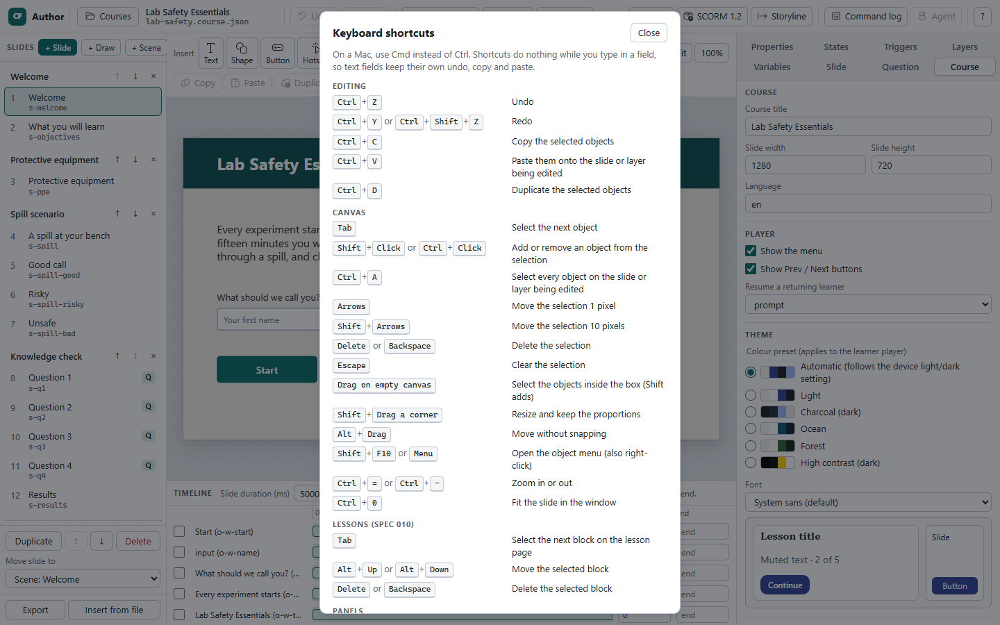

## 20. Claude, your AI assistant

CourseForge Studio uses **Claude Code** on your computer, signed in with your own Claude account, so there is no key to paste and nothing extra to pay for beyond your Claude plan. AI is off until you turn it on.

**Set up (once).**
1. Install Claude Code from [claude.com/claude-code](https://claude.com/claude-code).
2. Open Windows Terminal, type `claude`, press Enter, then type `/login` and sign in in your browser.
3. In CourseForge Studio, click **Set up Claude** on the start screen (or the gear in the Claude panel). The three checks turn green: installed, signed in, turned on.

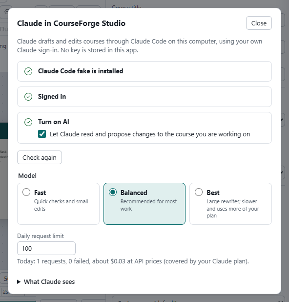

In the same dialog you choose the model (**Fast**, **Balanced** or **Best**) and a **daily request limit** (100 by default). Today's use is shown underneath. **What Claude sees** explains exactly what is sent: your request, the open course, and any document you attach.

**Ask for a change.** Open a course and click **Ask Claude** (Ctrl+I). Type what you want in your own words, for example *Add alt text to every image* or *Rewrite this slide in plainer language*, and press **Send** (Ctrl+Enter). With **About slide …** ticked, "this slide" means the slide you are on.

Claude works on a copy of your course. When it finishes, a **change card** shows what it did, the exact lines that changed (green added, red removed) and the commands it ran. Click **Apply** to make the change, or **Discard** to throw it away. An applied change is one step: **Undo** reverses it. If you edit the course while Claude is working, Apply is refused so nothing you did is overwritten; ask again.

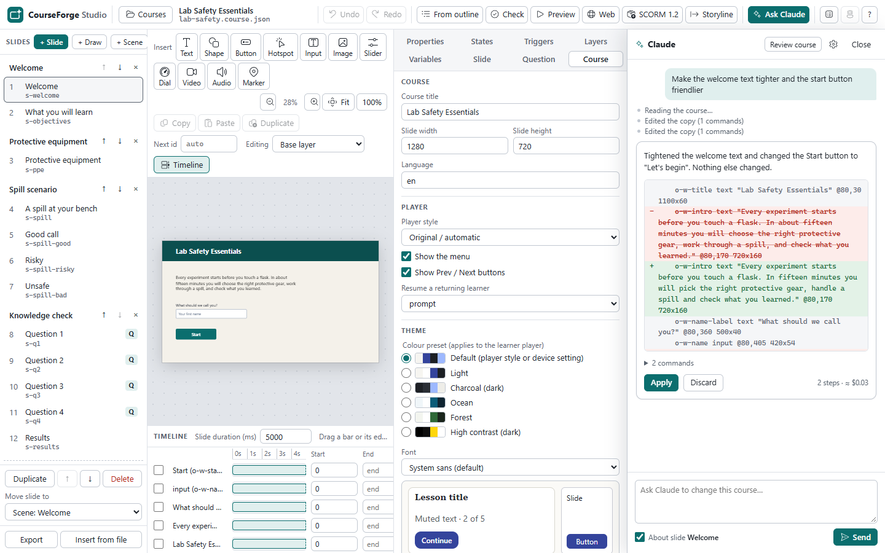

**Create a course with AI.** On the start screen, click **Create with AI**:
1. **Brief**: say what the course should teach and who it is for, pick a length and a type, and attach source documents if you have them (Word, PDF, Markdown or text).
2. **Outline**: Claude drafts an outline sized to the length you picked. Edit the title, the file name and any line of the outline, or click **Draft again**.
3. **Build**: Claude builds the course one scene or section at a time. The new course appears on the start screen only when it is complete. If building stops (for example at your daily limit), click **Continue building**: finished parts are kept.

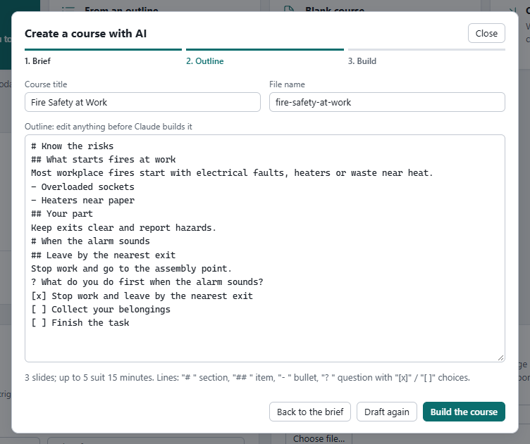

**Review a course.** In the Claude panel, click **Review course**. Claude reads the whole course and lists up to ten things to fix, most important first. **Fix with Claude** sends a finding to the assistant, which proposes the fix as a change card.

**Other AI tools.** Everything you can do in the editor, other assistants can do through the same commands, using the `cf` command line, a local web interface or MCP. **Command log** shows each change you make as a command; **Agent** shows how an assistant would make the same change. See the [agent guide](agent-guide.md) and the [command reference](commands.md).

## 21. Troubleshooting

| Problem | What to do |
|---|---|
| A message says CourseForge Studio could not start | Read the reason in the message and follow its advice. The details are saved in `%APPDATA%\CourseForge Studio\logs\main.log`. |
| Windows says it "protected your PC" when installing | Click **More info**, then **Run anyway**. The installer is not code-signed yet. |
| "Claude Code is not installed" or "not signed in" | Follow the steps in [section 20](#20-claude-your-ai-assistant), then click **Check again** in AI settings. |
| Claude says it is busy or at its usage limit | Wait a few minutes and try again. Your course was not changed. |
| "You have used today's AI requests" | The limit resets at midnight (UTC). You can raise it in AI settings. |
| The window feels cramped | Make it wider. Below 1024 pixels, the editor scrolls sideways. |
| A change shows **Not saved** | Read the message beside the field, correct the value and leave the field again. |
| Fonts look different for learners | Use fonts installed on learners' computers. Fonts are not embedded. |
| Learners lose their place in a very long SCORM course | The course's resume data is over the SCORM 1.2 limit. Split the course or use fewer variables. |
| An imported course looks different from the original | Open `<name>.import-report.json` next to the course. Every approximation and omission is listed there. |

---

CourseForge Studio is MIT-licensed open software. Storyline 360, Microsoft PowerPoint and Excel are trademarks of their owners and are named here only to describe file compatibility.
